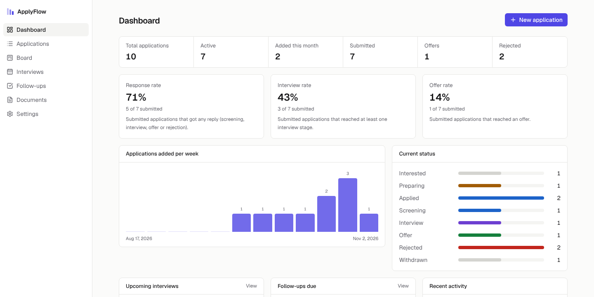

# ApplyFlow

Job-search management for people who apply seriously: every application,
status change, interview, follow-up and CV version in one place, with metrics
computed from what actually happened.



**Try it without an account:** the landing page has a *Try the demo* button
that creates a private sandbox with sample data, deleted after 24 hours.

## Features

- **Pipeline**: twelve stages, table view (search, filters, sort, pagination)
  and a Kanban board with persisted drag and drop
- **History**: every status change is an append-only event with optional
  note; nothing is silently overwritten
- **Dashboard**: response, interview and offer rates computed from the event
  history (a rejection after interviews still counts as an interview), with
  small samples flagged instead of presented as trends
- **Interviews**: scheduled in their own timezone, shown in yours; outcomes,
  feedback, month calendar
- **Follow-ups**: overdue / today / upcoming, per application or general
- **Documents**: CV and cover-letter versions in private storage, type
  checked from file contents, downloadable only by their owner
- **Discover**: saved searches on La Bonne Alternance (France's public
  apprenticeship job service); new offers daily, one click to add to the pipeline
- **Telegram bot**: send a job link from your phone and it lands in your
  pipeline; daily new offers with buttons; reminders before interviews and
  when a follow-up is due
- **English and French**, light and dark mode, responsive down to phones

## Stack

Next.js 16 (App Router, Cache Components) · React 19 · TypeScript strict ·
Tailwind CSS 4 · PostgreSQL 16 · Drizzle ORM · better-auth · Zod ·
dnd-kit · Vitest · Playwright + axe · Docker · GitHub Actions

## Architecture

A modular monolith with one-way dependencies:
`app/` (UI) → `server/actions` (auth + validation) → `server/services`
(business rules) → `server/db`.

- **Tenant isolation in three layers**: every query is scoped by the session's
  user id; user-owned tables reference each other through composite
  `(user_id, id)` foreign keys, so the database itself rejects cross-user
  links; and automated tests try every operation as the wrong user.
- **Correct under concurrency**: status changes lock the row, and event
  timestamps use `clock_timestamp()` so the timeline order matches commit order.
- **Little client JavaScript**: Server Components and Server Actions; charts
  are server-rendered. The board is the only heavy client component.

Details: [ARCHITECTURE](docs/ARCHITECTURE.md) · [DATABASE](docs/DATABASE.md) ·
[API](docs/API.md) · [SECURITY](docs/SECURITY.md) · [TESTING](docs/TESTING.md) ·
[DEPLOYMENT](docs/DEPLOYMENT.md) · [DEVELOPMENT](docs/DEVELOPMENT.md) ·
ADRs: [0001](docs/adr/0001-drizzle-instead-of-prisma.md),
[0002](docs/adr/0002-server-actions-over-rest.md),
[0003](docs/adr/0003-local-storage-default.md),
[0004](docs/adr/0004-telegram-and-discovery.md)

## Run locally

Requirements: Node 22, pnpm 10, PostgreSQL 16.

```bash
cp .env.example .env           # set BETTER_AUTH_SECRET: openssl rand -base64 32
pnpm install
pnpm db:migrate
pnpm dev                       # http://localhost:3000
```

Or the whole stack: `POSTGRES_PASSWORD=… docker compose up -d --build`.

### Environment variables

| Variable | Required | Purpose |
|---|---|---|
| `APP_URL` | yes | Public base URL |
| `DATABASE_URL` | yes | PostgreSQL connection |
| `BETTER_AUTH_SECRET` | yes | ≥ 32 chars, signs sessions |
| `STORAGE_DRIVER` | no | `local` (default) or `s3` |
| `STORAGE_DIR` | no | Directory for `local` |
| `S3_*` | if `s3` | Endpoint, region, bucket, keys |
| `RESEND_API_KEY`, `EMAIL_FROM` | no | Enables email verification and password reset |
| `DEMO_RATE_LIMIT_PER_HOUR` | no | Demo sandboxes per IP per hour (default 5) |
| `LBA_API_KEY` | no | Enables Discover (La Bonne Alternance, non-commercial use) |
| `TELEGRAM_BOT_TOKEN`, `TELEGRAM_BOT_USERNAME`, `TELEGRAM_WEBHOOK_SECRET` | no, all or none | Enables the Telegram bot |
| `CRON_SECRET` | for scheduled jobs | Protects `/api/cron/*` |

The app refuses to start if the configuration is invalid.

## Commands

| Command | Purpose |
|---|---|
| `pnpm dev` | Development server |
| `pnpm lint` / `pnpm typecheck` | ESLint / TypeScript |
| `pnpm test` | Unit + integration tests (needs a test database, see TESTING) |
| `pnpm build && scripts/serve-standalone.sh` | Production build on :3100 |
| `pnpm exec playwright test` | End-to-end tests against that build |
| `pnpm db:generate` / `pnpm db:migrate` | Create / apply migrations |

## Status

The MVP plus the Telegram bot and job discovery are implemented and tested:
68 unit/integration tests and 12 end-to-end tests pass. Deferred modules (recruiter CRM, AI features, job
discovery, notifications) and their prerequisites are listed in
[IMPLEMENTATION_PLAN](docs/IMPLEMENTATION_PLAN.md). Known limitations are in
[SECURITY](docs/SECURITY.md#known-limitations).

---

Built by Siavash Izadi.
