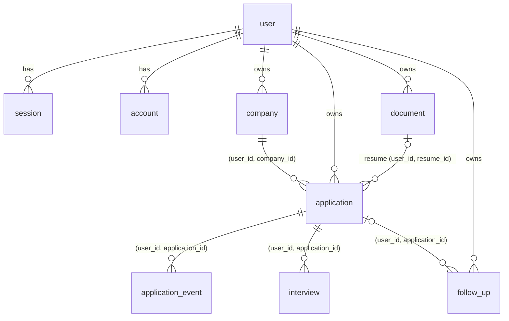

# Database

PostgreSQL 16, schema in `src/server/db/schema.ts`, SQL migrations in
`drizzle/` (generated by drizzle-kit and committed; CI fails if the schema and
the migrations drift apart).



## Tables

| Table | Purpose | Notes |
|---|---|---|
| `user`, `session`, `account`, `verification` | better-auth | `user` adds `locale`, `timezone`, `is_demo`, `demo_expires_at` |
| `rate_limit` | auth + demo rate limits | atomic upsert counter |
| `company` | per-user companies | unique `(user_id, lower(name))` |
| `application` | the core entity | current `status` + `position` (Kanban order) |
| `application_event` | append-only status history | written in the same transaction as the status change |
| `interview` | scheduled interviews | stores UTC instant **and** the IANA zone it was scheduled in |
| `follow_up` | reminders | due date stored as UTC midnight of the chosen day |
| `document` | metadata for files in storage | soft-deleted; object removed on delete |

## Design decisions

- **Ownership in the keys.** Each user-owned table has `UNIQUE (user_id, id)`;
  references use composite FKs, so a cross-user reference cannot exist.
- **History, not snapshots.** Metrics read `application_event`.
  `occurred_at` defaults to `clock_timestamp()` rather than `now()`: `now()` is
  the transaction start, which misorders a transition that waited on a row
  lock. Found by a concurrency test, fixed in migration `0001`.
- **Concurrency.** Status changes lock the application row (`SELECT … FOR
  UPDATE`), so concurrent changes form a valid `from → to` chain.
- **Kanban ordering.** Integer positions with gaps of 1024; a drop takes the
  midpoint between neighbours, and the column is renumbered only when the gap
  is exhausted.
- **Cascades.** Deleting a user removes everything; deleting an application
  removes its events, interviews and follow-ups. Deleting a company used by an
  application is blocked (`RESTRICT`).
- **Indexes follow queries**: `(user_id, status, position)` for the board,
  `(user_id, created_at)` for lists and charts, `(user_id, deadline)`, a
  partial index on open follow-ups by due date, `(user_id, scheduled_at)` for
  interviews.

## Commands

```bash
pnpm db:generate   # new migration from schema changes (review the SQL!)
pnpm db:migrate    # apply pending migrations
```

Migrations are additive where possible so the previous app version keeps
working during a deploy. Development data comes only from the demo seeder
(`src/server/services/demo.ts`), which creates fictional companies inside a
sandbox account; there is no seed script that touches real accounts.
